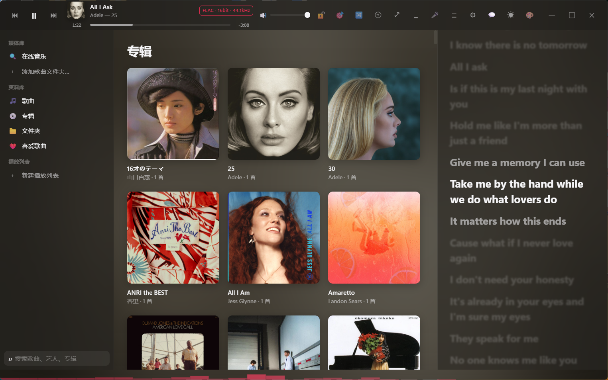
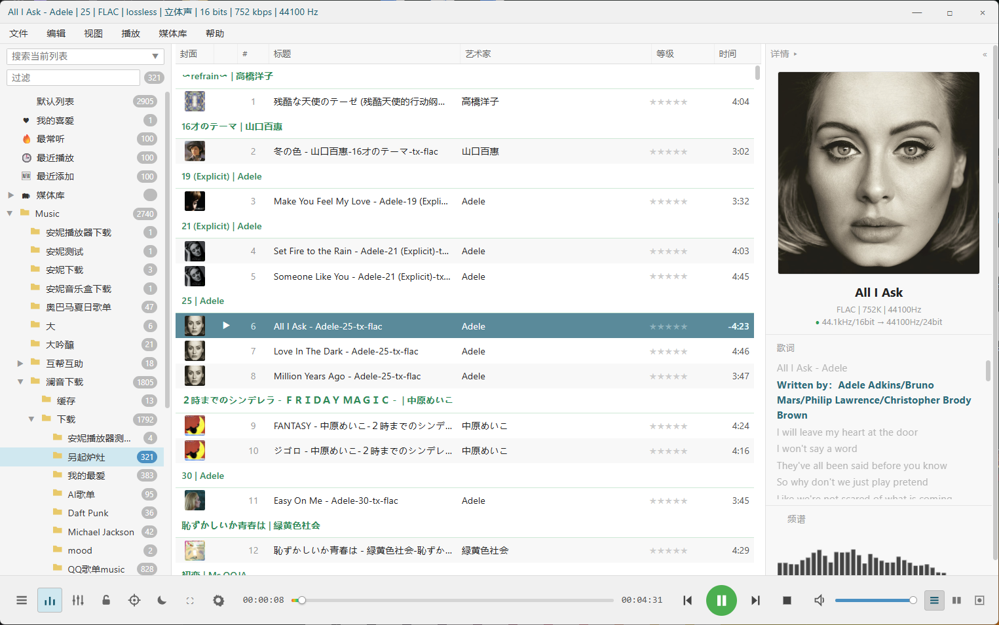
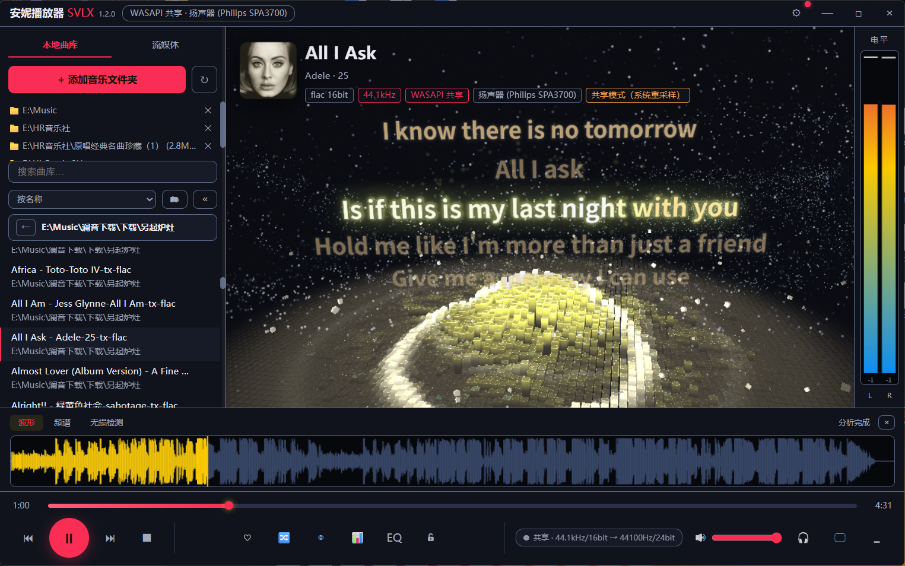
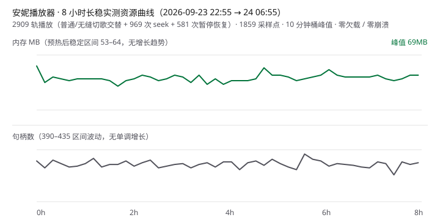

<div align="center">

# 安妮播放器融合版（AnniePlayer SVLX）

**Windows / macOS HiFi 桌面音乐播放器**
本地无损曲库 × 洛雪音乐生态 × 三套界面主题；Windows 自研 AnnieEngine（WASAPI / ASIO / VST3），macOS 原生 Swift / CoreAudio

[](https://github.com/Zhou1019-1/AnniePlayer-LXversion/releases/latest)
[](https://github.com/Zhou1019-1/AnniePlayer-LXversion/releases)
[](https://github.com/Zhou1019-1/AnniePlayer-LXversion/actions/workflows/release.yml)
[](#下载安装)
[](https://github.com/Zhou1019-1/AnniePlayer-LXversion/releases/tag/mac-v1.0.2)
[](#annieengine独立音频引擎)
[](LICENSE)

**[Windows 下载](https://github.com/Zhou1019-1/AnniePlayer-LXversion/releases/latest) · [macOS 下载](https://github.com/Zhou1019-1/AnniePlayer-LXversion/releases/tag/mac-v1.0.2) · [界面截图](#界面截图) · [核心卖点](#核心卖点) · [更新日志](更新日志.md) · [全功能说明书](#全功能说明书)**

无敌章鱼哥出品 · 交流 Q 群 **1023637098**（更多 HiFi 资源群公告获取）

</div>

> **Windows 主线 · V5.0.0**：全新从零全功能说明书、Qobuz 封面代理修复、Apple Music 播放与网络稳定性修复已发布。本版为 2026 年最后一次公共版本更新，更多内测功能仅限开发者小范围分享。
>
> 🍎 **macOS ARM64 · V1.0.2 已发布**：由社区成员 **numb** 完成原生 Swift + WKWebView / CoreAudio 移植，提供 DMG 与 ZIP 下载；采用独立 `mac-v*` 预发布通道，不影响 Windows 在线更新。

## 核心卖点

- 🎧 **独立音频引擎 AnnieEngine**：.NET 9 独立进程承担解码 / DSP / 输出，UI 崩溃不影响播放，引擎异常自动恢复
- 🎯 **Bit-perfect 可验证**：WASAPI 独占 / ASIO 直通，输出健康链路图 11 个环节逐段显示真实参数
- 🎛️ **完整 DSP 链**：15 段 EQ + 8 段参量 EQ + 声道矩阵 + 响度均衡（ReplayGain 直读）+ VST3 效果器，全部热更新不破音
- 🌐 **在线音源三生态**：洛雪五平台（酷狗/酷我/咪咕/QQ/网易）+ Qobuz 直连 + Apple Music（实验性），搜索/播放/歌单/下载全套
- ⬇️ **下载即成品**：落盘自动写入全套标签 + 封面 + 歌词（GBK 编码兼容老设备/车载）
- 🎨 **三套界面主题**：Apple Music（磨砂玻璃）/ FB2K（效率）/ 粒子舞台（3D 可视化），彩胶唱片沉浸模式
- 🧰 **曲库工具链**：媒体库体检 / 备份迁移换机 / 无损鉴别 / 听歌统计热力图 / 诊断包导出
- ✅ **工程化可信**：27 项音频正确性断言 CI 双闸门 + 8 小时长稳实测 2909 轨零错误

## 下载安装

### Windows

**[→ 下载 Windows 最新安装包](https://github.com/Zhou1019-1/AnniePlayer-LXversion/releases/latest)**（`annie-player-svlx-setup-x.y.z.exe`，约 386MB，含 Apple Music 音源运行时）

- 系统要求：**Windows 10 / 11 64 位**（1607+；不支持 Windows 7/8——Electron 与 .NET 9 均已不再支持）；内置全部运行库，无需装 .NET / VLC / 任何依赖
- 安装包未购买代码签名，SmartScreen 提示时点 **「更多信息 → 仍要运行」** 即可
- **在线更新**：V3.3.1 之后的版本支持差量自动更新，打开软件即静默下载、下次启动生效（每次只需下载几 MB）
- 覆盖安装 / 升级不会丢失曲库、歌单与设置（数据在 `%APPDATA%\annie-player-svlx`）

### macOS（Apple Silicon）

**[→ 下载 macOS V1.0.2（DMG / ZIP）](https://github.com/Zhou1019-1/AnniePlayer-LXversion/releases/tag/mac-v1.0.2)**（社区成员 **numb** 移植）

- 系统要求：**macOS 15.0+ · Apple Silicon（ARM64）**；原生 Swift + WKWebView 外壳，AVFoundation / CoreAudio 音频后端
- 当前提供 DMG 与 ARM64 ZIP；未签名版本首次打开请使用 **「右键 → 打开」** 并按系统提示允许
- macOS 使用独立 `mac-v*` 预发布通道，不会抢用 Windows 的 `releases/latest` 在线更新入口
- 功能清单、构建方法与已知限制见 [macOS 版说明](macos/README.md)；当前 QQ 音乐搜索可用，播放仍受后端风控限制

## 界面截图

| Apple Music 主题 | FB2K 主题 | 粒子舞台 |
| :---: | :---: | :---: |
|  |  |  |

## AnnieEngine：独立音频引擎

AnniePlayer 的核心音频后端是独立进程 **AnnieEngine**（.NET 9）。Electron 不直接参与音频输出，只通过 JSON-RPC 下发控制指令、接收状态事件。

```text
                AnniePlayer SVLX
                      │
       ┌──────────────┴──────────────┐
       │                             │
  Electron UI                  LX Music SDK
  （三套主题/曲库/交互）         （五平台在线音源）
       └──────────────┬──────────────┘
                      │ JSON-RPC (stdio)
                      ▼
              ┌───────────────┐
              │  AnnieEngine  │  独立进程 · .NET 9
              │  播放状态机    │
              └──────┬────────┘
                     │
   ┌─────────┬───────┼────────┬──────────┐
   ▼         ▼       ▼        ▼          ▼
 解码       DSP     插件    混音        输出
 FFmpeg   Float32  VST3   Gapless    WASAPI
 全格式   PCM 管线         Crossfade  独占/共享
                     │                ASIO
                     ▼                 │
        EQ/PEQ/声道矩阵/响度/限幅       ▼
                     │                DAC
                     ▼
              重采样（swresample/soxr）
```

**引擎特性**

- 独立进程架构：渲染层崩溃不影响播放链路；引擎异常退出可独立重启恢复
- FFmpeg 解码（本地文件 / HTTP 流 / CUE / SACD ISO），float32 PCM 域处理
- WASAPI 独占 / 共享、ASIO 输出；DSD 转 PCM / DoP 直通
- DSP 链：15 段图示 EQ + 8 段参量 EQ + 声道矩阵 + 响度增益 + 自动前级 + 软限幅，全部热更新不破音
- Gapless 无缝播放与交叉淡入（引擎内混音器，切歌不重建输出流）
- 输出健康监控：缓冲水位 / 欠载计数 / 限幅触发实时上报
- 内置 `test.decode` 自测接口：不开输出设备拉取整条 DSP 链返回计量指标，供 CI 断言

**为什么用独立引擎？** 音频实时处理对时延与稳定性敏感：独立进程让 UI 线程完全离开音频回调路径，解码 / DSP / 输出与界面解耦，WASAPI / ASIO / VST3 有独立运行环境，引擎也可脱离 UI 单独做自动化正确性测试。

### 引擎内部信号链

```text
源文件 / 流（FLAC · APE · DSD · CUE · SACD ISO）
    ↓
FFmpeg 解码 ──────── DSD64–512（原生 / DoP / 转 PCM 三档）
    ↓
Float32 PCM（全程浮点）
    ↓
VST3 插件槽位 ×N（实时链，可挂原生编辑器）
    ↓
图示 EQ 15 段（32Hz–16kHz）
    ↓
参量 EQ 8 段（f / g / Q）
    ↓
声道矩阵（上混 / 下混 / 平衡 / 互换 / 5.1 环绕）
    ↓
响度增益（ReplayGain / 预设均衡）
    ↓
前级限幅（防削波）
    ↓
重采样（soxr 高精度，可选 44.1k–384k）
    ↓
┌───┴───┐
WASAPI   ASIO
独占/共享
└───┬───┘
    ↓
   DAC
```

## 音质链路：Bit-perfect 可验证

「设置中心 → 音频输出 → 输出健康」的链路图可点击展开，11 个环节逐段显示真实参数并给出 bit-perfect 判定（V4.0.1）。两种典型状态：

**直通状态**（输出格式匹配且未启用任何 DSP / 重采样）：

```text
FLAC 24bit/96kHz
  → FFmpeg 解码 → Float32
  → DSP 全部直通（VST/EQ/PEQ/矩阵/响度 OFF）
  → 无重采样
  → WASAPI 独占 24bit/96kHz
  → DAC
  ✓ BIT-PERFECT
```

**DSP 激活状态**（数字域处理中，每一环都可查证，不再是 bit-perfect）：

```text
FLAC 24/96
  → Float32
  → 参量 EQ +3dB @1kHz
  → 响度均衡（标准模式 -3.0dB）
  → 限幅待命（余量 +5.0dB）
  → 重采样 96k → 192k（soxr）
  → WASAPI 独占 24/192
  → DAC
  ✗ 非 bit-perfect（原因：响度 / EQ / 重采样，浮层逐项列出）
```

<details>
<summary><strong>📈 性能实测（曲库 Benchmark + 8 小时长稳，点击展开）</strong></summary>

## 性能实测

曲库性能 Benchmark（`npm run bench:library` 可自行复现；扫描列为真实文件实测，启动/排序/搜索/内存为合成数据层实测，**排序直接执行生产代码 listWorker.js**）：

| 曲库规模 | 扫描（遍历+拼音排序） | 元数据解析（估算） | 启动加载 | 排序·名称 | 排序·专辑分组 | 搜索 | 内存占用 |
| ---: | ---: | ---: | ---: | ---: | ---: | ---: | ---: |
| 1,000 | 70 ms | 1.6 s（冷启动） | 5 ms | 2 ms | 2 ms | 0 ms | 1 MB |
| 10,000 | 131 ms | 3.3 s | 26 ms | 19 ms | 19 ms | 3 ms | 6 MB |
| 50,000 | 532 ms | 13.7 s | 107 ms | 80 ms | 118 ms | 18 ms | 25 MB |
| 100,000 | — | — | 212 ms | 160 ms | 271 ms | 42 ms | 49 MB |
| 200,000 | — | — | 454 ms | 297 ms | 543 ms | 49 ms | 77 MB |

实测环境：Intel Core Ultra 9 275HX / Node 24 / Windows 11（数据随机型与磁盘波动，数量级可靠）。元数据解析仅在首次全量扫描发生，之后按文件修改时间增量更新；20 万首数据层存储 JSON 约 33 MB。

长稳实测（`npm run test:soak` 自动出报告）：



| 时长 | 场景 | 播放 | 内存 | 句柄/线程 | 欠载 | 结果 |
| --- | --- | --- | --- | --- | --- | --- |
| 8h（2026-09-23→24） | WASAPI 共享 · gapless 开 · 混合采样率素材（44.1k/48k/96k/单声道），普通/无缝切歌交替 + 969 次 seek + 581 次暂停恢复 | 2909 轨零错误 | 预热后稳定 53–64MB（峰值 69MB），无增长趋势 | 390–435 波动无单调增长 / 14–21 波动 | 0 次（1859 采样点） | ✓ PASS |

24h/48h 长稳数据积累中，跑完补到这里。

</details>

<details>
<summary><strong>🔬 音频正确性测试（27 项断言 CI 双闸门，点击展开）</strong></summary>

## 音频正确性测试

引擎内置 `test.decode` 自检接口（不依赖声卡，拉取整条 DSP 链返回实测指标），每次提交由 CI 自动执行（ci.yml 与 release.yml 双闸门）：

**27 / 27 PASS**

- ✓ 采样率直通（44.1k / 48k）　✓ 重采样（soxr：帧数精确 + 带宽保持）
- ✓ 声道矩阵（单声道→立体声 / 立体声→单声道 / 自定义矩阵 / 5.1 环绕能量守恒）
- ✓ 图示 EQ（+6dB @1kHz）　✓ 参量 EQ（增益 / 段间叠加 / 全关直通 / 非法参数拒绝）
- ✓ 前级限幅（TP>1 压回阈值）　✓ 防削波链（EQ +12dB 时限幅自动待命）
- ✓ 响度增益　✓ 削波恢复　✓ 边界用例（空文件 / 极端音量 / 声道探测 / 循环受控 / 快速播放）

复现：`npm run test:audio`

</details>

## 三套界面主题（设置中心 → 常规，随时切换）

| 主题 | 风格 | 适合 |
| --- | --- | --- |
| **Apple Music** | 磨砂玻璃 + 封面氛围背景 + 大字逐行歌词，亮/暗双主题 | 默认主题，颜值党 |
| **FB2K** | 仿 foobar2000 经典布局，信息密度高，虚拟滚动面向大规模曲库优化 | 效率党 |
| **粒子舞台** | Three.js 3D 粒子可视化舞台，13 个视觉预设，节拍驱动相机 | 视觉党、投屏氛围 |

## 技术栈

| 层 | 技术 |
| --- | --- |
| UI | Electron / JavaScript |
| 音频引擎 | C# / .NET 9（独立进程，JSON-RPC stdio） |
| 解码 | FFmpeg |
| 音频输出 | WASAPI（独占/共享）/ ASIO |
| DSP | 自研 float32 PCM 管线（EQ/PEQ/声道矩阵/响度/限幅） |
| 插件 | VST3 |
| 可视化 | Three.js |
| 在线音源 | 洛雪 musicSdk（酷狗/酷我/咪咕/QQ/网易） |
| 构建 / CI | npm / electron-builder / GitHub Actions |
| 测试 | lavfi 合成音源 + 引擎自测接口 27 项断言 / 冒烟测试 |

## 项目状态

当前版本：**Windows V5.0.0 / macOS V1.0.2（ARM64）**

> 📢 Windows 主线目前以重大问题修复和小幅体验打磨为主；macOS 版由社区成员 **numb** 维护，使用独立 `mac-v*` 发版线（见 `macos/` 目录）。

**已完成**

- [x] 本地曲库（全格式 / CUE / SACD ISO / 无损鉴别（四方法加权融合）/ 标签批量编辑）
- [x] WASAPI 独占 / 共享、ASIO、DSD（转 PCM / DoP）
- [x] DSP 链：15 段 EQ / 参量 EQ / 声道工具箱 / 响度均衡（EBU R128 + ReplayGain 直读）
- [x] VST3 效果器链（原生编辑器 / 性能监控 / 崩溃自动旁通）
- [x] Gapless 无缝播放 / 交叉淡入
- [x] 洛雪五平台在线音源（搜索/播放/下载/歌单导入）
- [x] 三套界面主题 / 桌面歌词 / SMTC 系统媒体控制
- [x] 差量自动更新 / 引擎崩溃熔断与恢复 / 诊断包导出
- [x] CI：JS 语法 + 引擎编译 + 冒烟测试 + **音频正确性测试集（27 项断言）** 双闸门
- [x] 引擎核心模块化拆分（RPC 分发 / DSP / VST / 播放控制 四 partial class）
- [x] 长稳测试脚本（`npm run test:soak`：循环播放 + 内存/句柄/欠载采样，Markdown 报告）——**8 小时实测 PASS**：2909 轨零错误，内存 53–64MB 收敛，零欠载
- [x] 曲库性能 Benchmark 工具（`npm run bench:library`：1k~20 万级，排序直测生产 listWorker 代码）
- [x] am.js UI 层拆分（2448 行单 IIFE → 核心数据/在线音乐/歌词/界面构建/状态刷新 5 片，内部模块桥接，切片拼接与原稿逐字节一致 + 引用审计 + 沙箱烟测三重校验，零行为变更）
- [x] Apple Music 音源（实验性）：登录自己的 Apple 账号，ALAC 流式 / AAC 缓冲双档播放、五档下载全套标签、播放加载进度卡（V4.6.0）
- [x] 社区协作：秋野奈四批 PR（可拖分栏 / SVG 图标 / 拖动保护 / 内存优化 / 歌词折行 / 待播插队 / 随机可见化等数十项）全部评审合入
- [x] macOS ARM64 版（社区成员 numb）：原生 Swift + WKWebView / CoreAudio，V1.0.2 已发布 DMG / ZIP，独立 `mac-v*` 发版线

**进行中**

- [ ] 长稳与曲库实测数据积累（24h/48h 连续播放、20 万级真实曲库）

<details>
<summary><strong>📦 核心能力全清单（音质链路 / 曲库管理 / 在线与下载 / 交互体验，点击展开）</strong></summary>

## 核心能力

**音质链路**
- WASAPI 独占 / 共享、ASIO 直通（面板/采样率/缓冲控制）、DSD 转 PCM / DoP
- 输出格式匹配且未启用重采样时可达 bit-perfect 直通（状态点绿/黄实时指示，悬停看原因）
- 15 段图示 EQ + 8 段参量 EQ（引擎热更新不破音）、声道工具箱（平衡/互换/单声道/反相）
- 响度均衡 EBU R128（目标 -16 LUFS，**ReplayGain 标签直读免分析**）
- 削波防护（自动前级 + tanh 软限幅）、重采样质量档位（标准 / 高质量 64 阶滤波）
- 无缝播放 Gapless（切歌保持输出流，间隙毫秒级）、交叉淡入 0–10s
- 输出设备打开失败时自动回退 WASAPI 共享输出并弹提示
- 音质链路图：源 → DSP 各段 → 输出可视化，点击展开全参数对照（Bit-perfect 结论 + 原因）

**曲库管理**
- 全格式：FLAC / APE / WAV / DSF / DFF / TTA / M4A / MP3 / OGG / OPUS / WMA…
- CUE 整轨分轨、**SACD ISO 分轨**（sacd_extract）
- 标签编辑器（单曲 + **批量**，勾选式写回）、在线匹配歌词/封面（五平台）
- 无损鉴别（四方法加权融合：频谱截止/编码帧痕迹/位深量化/采样率上转换，整库/文件夹/单曲三种范围，可导出 CSV/HTML 报告，不在列表打标记）、重复歌曲检测、播放统计
- 自建播放列表（三主题共享）、喜爱列表、收藏不依赖云端

**在线音乐（洛雪深度融合）**
- 五大平台搜索/播放/下载：酷狗 / 酷我 / 咪咕 / QQ / 网易
- 音质分级 Hi-Res 24bit / 无损 / 320K / 128K（URL 实际格式校验，虚标自动降级）
- 榜单 / 歌单广场、**歌单链接一键导入**（五平台链接或纯 ID）
- **批量下载已加载结果**、搜索历史、自定义音源脚本导入（vm 沙箱）

**其他**
- 桌面歌词（独立透明窗，逐字卡拉OK）、三主题逐字歌词、**歌词偏移微调（±0.5s 按曲记忆）**
- 迷你模式（**一键置顶 📌**）、AM 沉浸播放页（**待播清单可拖拽排序/移除**）
- **SMTC 系统媒体控制**（媒体键全局控制、系统浮层显示封面）、任务栏进度条
- **氛围模式**（全屏实时频谱）、AM 底部频谱条、**强调色自定义**（7 色板三主题同步）
- **听歌报告**（Top 歌曲/艺术家/专辑、总时长、分享图一键复制）、更新播报、首次启动引导
- 全局快捷键（媒体键 + Ctrl+Alt 组合）、播放模式五种、播放定时三种
- VST3 效果器链（原生编辑器界面 / 湿声平滑过渡 / 每插件耗时 / 方案导入导出 / A-B 对比）
- 设置中心内置「**使用说明**」（说明书应用内版，全功能可搜索）

</details>

## 为什么做这个项目

AnniePlayer 最初只是一个本地音乐播放器。随着需求增加，UI、曲库、网络音源与音频输出之间的耦合越来越复杂，项目逐渐演变成**由独立音频引擎驱动的 Windows HiFi 播放平台**。

V4 起项目重点从「实现更多功能」转向：音频链路正确性（可断言的自动化测试）、实时处理稳定性（长稳监控）、引擎与 UI 解耦（模块化拆分）、大规模曲库性能、故障诊断与恢复。

<!-- HELP:BEGIN -->
<!-- 本章节由 scripts/gen-readme-help.js 自动生成（源：annie/renderer/js/local/helpContent.js），请勿手改 -->

## 全功能说明书

### 第一章 · 第一次使用

- **这是什么**：安妮播放器是 Windows 10/11 桌面 HiFi 播放器：本地曲库、国内五大在线平台、Qobuz 与 Apple Music（实验性）共用播放队列、歌词、下载任务和音频输出。自研 AnnieEngine 独立进程负责解码，支持 WASAPI、ASIO、独占输出与 Bit-perfect。
- **安装与首次启动**：① 运行安装包并按向导完成安装；② 启动后完成三步引导；③ 打开 设置 → 音频输出，先选正在发声的设备，不确定就用 WASAPI 共享模式；④ 返回主界面添加音乐文件夹。升级安装不需要卸载旧版，曲库和设置会保留。
- **第一次播放本地歌曲**：侧栏点「＋ / 添加歌曲文件夹」→ 选择一个存放音乐的文件夹 → 等扫描完成 → 打开「歌曲」→ 单击或双击曲目。不要一开始就把整个磁盘根目录加入曲库；音乐分散时可多次添加文件夹。
- **第一次播放在线歌曲**：国内平台：先按第二章导入可信音源，再进入「在线音乐」搜索；Qobuz：先按第五章登录付费账号；Apple Music：先按第六章启动服务并登录。在线歌曲只保存平台和曲目 ID，播放时实时取址，不是已经下载到电脑。
- **三套界面怎么选**：设置 → 常规 → 界面主题：Apple Music 界面适合日常曲库和在线音乐；仿 FB2K 适合大列表、排序和批量标签；粒子舞台适合视觉展示。主题共用曲库、歌单和播放状态，切换不会清空数据。本说明书以 Apple Music 界面路径为主，其他主题的对应入口见第八章。
- **支持的本地格式**：FLAC、APE、WavPack、TAK、DSF、DFF、WAV、AIFF、MP3、AAC、OGG、OPUS；支持 CUE 整轨分轨、SACD ISO 自动分轨和 HTTP/HTTPS 流。能否 Bit-perfect 还取决于输出设备、驱动和 DSP 设置。
- **下载、缓存、收藏不是一回事**：下载会生成可带走的音频文件；播放缓存只是在线播放的临时副本，用于下次秒开；收藏/在线歌单只保存曲目信息。清理缓存不会删除正式下载，删除收藏也不会删除本地音频。
- **数据目录与便携模式**：标准模式数据位于 %APPDATA%\安妮播放器融合版V3\。需要 U 盘携带时，在程序 exe 同目录新建 portable 文件夹，数据会存入 portable\userData\。换机优先使用「曲库备份与迁移」和歌单导出，不要只复制其中某一个 JSON。
- **账号与隐私总原则**：Qobuz、Apple Music 需要你自己的有效账号；国内音源通常不需要在安妮中登录平台账号。请只使用本人有权使用的账号和可信音源，不要把密码、token、Cookie、诊断包中的敏感信息发到公开群或 GitHub。公开说明书中的所有账号写法都应是占位示例。
- **推荐学习顺序**：只听本地：读第一、七、八、九章；国内在线与下载：读第二至四章；Qobuz：读第五章；Apple Music：读第六章。遇到网络或无声问题先查第十一章，不必反复重装。

### 第二章 · 国内在线音乐：音源配置与播放

- **支持平台与音源的作用**：国内在线音乐覆盖酷我、酷狗、QQ 音乐、网易云、咪咕。音源脚本负责搜索详情之外的播放地址、部分歌词和下载地址解析；没有可用音源时可能能浏览列表，却无法播放或下载。请使用与安妮兼容、来源可信的洛雪格式 .js 音源。
- **方式一：导入本地音源脚本**：① 打开 设置 → 扩展；② 点「导入音源脚本…」；③ 选择 .js 文件；④ 看到「导入成功并已启用」后回到在线音乐；⑤ 切换平台并搜索一首歌曲，点播放验证。安妮独家音源会自动完成宿主心跳验证，普通洛雪音源不需要这一步。
- **方式二：在线导入音源**：设置 → 扩展 →「在线导入…」→ 粘贴音源 .js 的 http/https 直链 → 确认。链接必须指向脚本本体，不是网页介绍页。在线导入的网络通道与浏览器代理可能不同，失败时可先把脚本下载到本地，再按方式一导入。
- **多音源启用、停用与删除**：设置 → 扩展 会列出已导入音源。可启用多个来源，解析失败时按实现自动尝试后续来源；停用后回退内置解析；删除只移除安妮中的配置，不影响原脚本文件。不要同时导入大量来源不明的脚本，排障时先只保留一个已知可用音源。
- **安全提示**：音源在隔离沙箱子进程中运行并禁用 eval/Function，但仍应只导入可信来源。带 #@安妮音源 vN 标识的独家脚本只能在安妮运行；普通洛雪脚本不受影响。不要在公开文档或 Issue 中粘贴带私人密钥、账号或服务器地址的音源全文。
- **搜索与播放**：进入 在线音乐 → 选平台 → 在搜索页输入歌名/歌手 → 点结果播放。排行榜、歌单广场、专辑页签可直接浏览；列表内筛选只过滤已经加载的结果。搜索历史可逐条删除或清空，播放列表会随当前搜索/详情结果连播。
- **在线音质怎么选**：页面音质下拉可选择 Hi-Res、无损、极高、标准等等级，具体可用档取决于平台和歌曲。播放时引擎会尝试所选档，必要时按可用音质回退；下载则是锁定档位，不会用静默降级冒充成功。顶栏在线徽标显示「音源·音质」，本地歌曲显示真实编码/位深/采样率。
- **QQ Hi-Res 为什么更严格**：搜索、歌单、专辑和排行榜会按 songmid 补全 QQ 官方单曲详情，只有官方详情明确存在 Hi-Res 才显示对应档位和大小。普通 FLAC 不会因为容器是 24bit 就被当作 QQ 官方 Hi-Res；下载完成后仍以 ffprobe 实测参数回显。大歌单会分批刷新，刚打开时稍等片刻即可。
- **播放缓存**：设置 → 下载 → 播放缓存：可开关、选目录、设 512MB–20GB 上限、按平台×音质查看和清理。完整播放过的国内在线歌曲会缓存；命中时徽标变绿并提示本地缓存秒开。缓存超限自动清理最久未使用内容，不是正式音乐库，也不要把缓存目录当下载目录管理。
- **国内播放失败的排查顺序**：① 换一首不同平台的歌，确认不是单曲版权限制；② 检查音源是否启用；③ 更新或更换可信音源；④ 关闭无效代理或确认国内平台可直连；⑤ 在设置 → 音频输出改 WASAPI 共享测试；⑥ 仍失败再导出诊断包。不要只看搜索能出结果就判断音源正常。

### 第三章 · 国内流媒体下载完整教学

- **本章适用范围**：本章的锁定音质、.part 断点续传、链接过期重新取址、自动换源和详细下载设置针对国内五平台。Qobuz 与 Apple Music 有各自链路，不要把本章的暂停续传能力直接套到它们身上。
- **下载前先做三项设置**：打开 设置 → 下载：① 点下载目录并选择正式保存位置；② 设置同时下载任务数，普通网络建议 2–3；③ 选文件命名方式和同名文件处理。确认目录可写、磁盘空间足够，再开始批量任务。
- **下载单首歌曲**：在搜索结果、榜单、专辑或歌单详情中点曲目行的下载按钮 → 在弹窗中选择该曲真实提供的音质 → 到侧栏「下载情况」查看进度。单曲下载不会自动归入某个歌单文件夹，除非任务本身来自带分组上下文的详情页。
- **批量下载歌单或专辑**：进入详情页后可点「下载全部 / 下载已加载 N 首」，或右键「多选」勾选部分曲目后下载。多选/批量按每首歌各自真实最高音质入队，上限 Hi-Res；不会给所有歌强行指定同一个不存在的档位。歌单/专辑任务会自动建立同名子文件夹。
- **下载目录与文件命名**：设置 → 下载 可更改/恢复默认目录；命名支持「艺术家 - 歌曲名」「歌曲名 - 艺术家」「歌曲名」。批量详情任务按歌单或专辑名建子目录，单曲与搜索下载仍落根目录。下载情况的文件夹按钮可打开对应目录，歌单任务可直达其子文件夹。
- **同名文件与重复音质**：开启「同名文件已存在时跳过」可避免重复下载；关闭则自动追加序号另存。队列去重键包含平台、歌曲 ID 和音质，所以同一首歌可以同时下载多个音质。正式下载前请先决定是否需要保留多档，避免无谓占用空间。
- **嵌入封面和歌词**：设置 → 下载 可分别控制嵌入封面、嵌入歌词，以及翻译、罗马音、逐字歌词。逐字内容使用 awlrc 扩展标签，只有支持的播放器才能逐字高亮；译文和罗马音合并前会按时间轴过滤，避免错行。嵌入内容保存在音频标签里，不依赖旁挂文件。
- **旁挂歌词与编码**：旁挂 .lrc 可与音频一起被其他播放器读取；可另选是否包含翻译、罗马音和逐字内容。老车机或旧播放器出现乱码时把歌词编码从 UTF-8 改为 GBK；现代播放器通常保持 UTF-8。修改设置影响新任务，不会自动重写所有旧文件。
- **暂停、继续与断点续传**：国内下载使用 .part 半成品：暂停或断网后保留已下载部分，继续时通过 Range 接着下；签名链接过期会重新取址续传；服务器忽略 Range 或返回异常时会安全地从头重下。网络错误自动重试，重启后未完成任务转为已暂停，需要手动继续。
- **自动换源与锁定音质**：开启「自动换源下载」后，当前平台失败会按歌名、歌手和时长寻找其他平台的同曲重试；关闭则只报当前任务错误。下载锁定用户所选档位，获取不到就失败并可重试，不会把普通 FLAC 冒充 Hi-Res。换源结果仍应核对艺人、版本和成品参数。
- **下载情况页怎么用**：侧栏 → 下载情况：在所有任务/正在下载/已暂停/出错/下载完成之间切换；可暂停、继续、重试、移除、打开目录。完成标签的一键清空和全任务清空只移除任务记录，不删除已下载音频；删除文件请在文件管理器或曲库删除流程中另行确认。
- **下载完成后的音质显示**：下载前显示的是你请求的目标档；完成后显示 ffprobe 读到的真实编码、位深和采样率。FLAC 的压缩码率不是位深，不能凭 1770kbps 等数字判断 16/24bit。官方平台是否标 Hi-Res 与文件实际参数是两套信息，说明书和界面均不混用。

### 第四章 · 在线伪本地歌单与平台歌单收藏

- **什么是在线伪本地歌单**：安妮中的「在线歌单」看起来像本地播放列表，但保存的是平台、歌曲 ID、标题、封面等快照，不是音频文件，也不是会过期的播放 URL。每次播放会重新解析地址，因此换机导入后仍能联网播放；它也不会自动变成正式下载。
- **新建在线歌单**：方法一：侧栏「在线歌单」分组点「＋」新建并命名。方法二：在任意在线歌曲的 ♥ 收藏弹层中选择「新建在线歌单」。新建后可从国内在线曲目添加歌曲；本地文件请使用本地播放列表，两类歌单不要混放。
- **收藏单首在线歌曲**：在搜索、榜单、专辑或歌单详情中点歌曲行 ♥ → 选择目标在线歌单；重复曲目会跳过。正在播放的在线歌曲也可用顶栏 ♥ 收藏。Apple Music 页面也提供收藏到在线歌单的入口，实际可播放性仍取决于对应服务是否可用。
- **批量收藏与收藏整专**：歌曲列表右键「多选」→ 勾选曲目 →「加到在线歌单」；专辑详情加载完整曲目后可点「收藏整专」。大量曲目收藏只保存快照，不会立刻下载。自制在线歌单打开时会后台刷新部分平台的旧音质快照，列表先显示、详情随后补齐。
- **收藏平台公开歌单**：进入 在线音乐 → 歌单广场，搜索或打开一个平台歌单 → 在详情页点「☆ 收藏歌单」。之后从侧栏「收藏的歌单」分组直达，再点一次可取消。这个收藏保存在安妮本机，不等于登录并收藏到 QQ/网易等平台官方账号。
- **通过链接导入平台歌单**：在线音乐的歌单区域点「导入歌单」→ 粘贴五大平台歌单分享链接，或输入纯数字 ID（按当前平台解析）→ 打开详情。确认曲目完整后再收藏或批量下载。若平台分页较多，等待加载完成并检查数量，不要只下载第一页。
- **播放与管理在线歌单**：侧栏点开在线歌单后可播放、随机播放、列表内筛选、拖拽管理或逐曲移除；头部 ♥ 可继续添加。在线播放联动顺序、随机、单曲循环和待播清单。删除在线歌单只删除收藏记录，不影响平台原歌单和已下载文件。
- **导出与换机导入**：右键在线歌单 →「导出在线歌单…」生成 .anniespl；另一台电脑通过侧栏在线歌单的导入入口载入。文件保存平台 ID 快照，不保存可用 URL、账号或密码；新设备仍需配置相应音源或服务。本地播放列表则导出 .anniepl，并按路径和多重指纹匹配本机文件。
- **常见误解**：收藏公开歌单 ≠ 把歌单复制成自制在线歌单；前者是平台详情快捷入口，后者是你自行挑曲的列表。收藏/导出 ≠ 下载；要离线带走音频仍需按第三章下载，并确认平台版权和使用许可。

### 第五章 · Qobuz 从零使用

- **账号与订阅要求**：需要你自己的 Qobuz 付费账号，且订阅、账号地区和曲目版权允许播放相应内容。安妮不提供账号、订阅或共享凭据。免费注册但无有效流媒体订阅的账号可能能登录，却无法获得完整播放或下载地址。
- **网络（科学上网）要求**：Qobuz 在部分网络或地区不可直接访问。请准备能正常访问 Qobuz 的网络，并在 Windows「系统代理」中正确配置；只安装浏览器插件、只有浏览器能开网页，不代表桌面应用会走同一代理。节点地区还会影响可搜索目录和可播放版权，必要时更换与账号地区匹配的节点。
- **代理自检方法**：先确认系统代理已开启，再在浏览器打开 Qobuz 官网并登录网页版；随后回到安妮重新登录或搜索。若浏览器也只能通过插件访问，请改用能提供系统级代理的方式。安妮的 Qobuz API、音频、封面和下载封面使用 Electron net.fetch 跟随系统代理，不需要在软件里另填代理地址。
- **登录账号**：① 侧栏打开 Qobuz；② 在登录卡输入你的邮箱和密码；③ 点「登录」并等待；④ 成功后进入搜索/收藏页面。「高级（自定义 app_id/secret）」一般保持留空，除非你很清楚自己的开发者参数。不要在截图、说明书或公开 Issue 中展示真实邮箱、密码、token 或 Cookie。
- **凭据保存与退出**：凭据仅加密保存在本机，用于维持登录和 token 过期后的自动重登。公共电脑上不建议保存账号；使用完毕后及时退出或清理应用数据。排查日志时也不要把含认证信息的原始配置上传到公开渠道。
- **搜索、收藏与我的歌单**：登录后可搜索专辑、单曲、歌单；快捷入口包括收藏专辑、收藏单曲和我的歌单。专辑/歌单详情中的 ♥ 会同步到你的 Qobuz 官方账号，与国内平台歌单的本机收藏不同。点专辑或歌单可查看完整曲目并逐首播放。
- **在线播放与音质**：Qobuz 提供多档音质，最高取决于账号订阅、曲目和平台返回，可包括 24bit/192kHz FLAC。选择音质后点曲目播放；搜索、专辑和歌单结果可整表连播，上一首/下一首及随机/循环模式与本地一致。实际位深和采样率以引擎 format 为准。
- **下载 Qobuz 音乐**：曲目行点下载可下单曲；专辑/歌单详情可下载全部；也可粘贴 Qobuz 链接或 ID 解析。下载目录可在账号区域单独选择，也可恢复与流媒体的默认关系。专辑按「艺人 - 专辑 / 序号 - 标题」归档，任务支持并发、失败重试和已有文件处理。
- **标签、内嵌封面与歌词**：下载后会写入标题、艺人、专辑、专辑艺术家、曲目号、碟号、年份、流派、厂牌、作曲家，并内嵌封面。歌词因 Qobuz 本身无接口，按 LRCLIB 优先、国内五平台兜底匹配，可嵌入并生成旁挂 .lrc。V5.0 已修复封面请求未随系统代理导致只写标签、没有内嵌封面的故障。
- **旧文件只补标签**：已经下载过的同名音频重新加入队列时，可跳过音频下载并再次执行标签/封面/歌词后处理，不必重新消耗整首流量。处理后可用标签编辑器、ffprobe 或其他播放器检查内嵌封面；不要把手工用 MP3tag 添加的封面误认为自动下载结果。
- **Qobuz 常见问题**：登录失败：先查系统代理、账号密码和订阅；能登录但不能播：检查曲目地区版权和音质；封面/搜索超时：检查代理节点；下载得到假 FLAC：新版会校验音频头并拒绝拦截页。仍失败时导出诊断包，公开分享前先脱敏。

### 第六章 · Apple Music 从零使用（实验性）

- **功能定位与账号要求**：Apple Music 音源和下载均为实验性，不作为稳定批量下载器承诺。需要你自己的有效 Apple Music 订阅；建议使用专用小号。搜索目录、账号地区、订阅和版权都会影响结果，Apple 官方政策或接口变化也可能导致功能暂时不可用。
- **网络与本机服务要求**：需要能访问 music.apple.com、Apple 播放 CDN 及 wrapper 所需服务。网络受限时同样要配置 Windows 系统代理，而不是只配置浏览器插件。wrapper 和播放服务使用 127.0.0.1 本机地址；若代理软件拦截本机回环，请把 127.0.0.1 和 localhost 加入绕过列表。
- **第一步：启动 wrapper 服务**：打开 设置 → Apple Music → 点「启动服务」，首次启动 QEMU 虚拟机通常需要约 15–30 秒。状态变成「服务运行中」并显示区域后再继续。Apple Music 页面也会尝试自动暖启动；安装或镜像到中文路径由软件处理，不要手工搬动 wrapper 文件。
- **第二步：登录自己的 Apple 账户**：服务运行后，在 设置 → Apple Music 或 Apple Music 页面引导中点「登录」→ 输入 Apple ID 与密码 → 如出现两步验证，输入受信任设备收到的 6 位验证码。登录过程会暂时停止并重新拉起服务，这是正常行为。不要把真实账号、密码或验证码写进公开反馈。
- **看懂服务状态**：正常状态应显示服务运行和非空区域（例如账号所在地区）。若显示「已连接，但未登录或实例异常」，先登录；已经登录仍出现则点「停止服务」，稍等后重新启动，避免接入旧的异常实例。仅端口能连通不代表账号已经可用。
- **搜索与链接解析**：侧栏打开 Apple Music：可搜索歌曲/专辑，也可粘贴 music.apple.com 的单曲、专辑或歌单链接，或输入数字 adamId。专辑和歌单解析后点曲目播放；结果可收藏到安妮在线歌单，但不等于同步到你的 Apple 官方资料库。
- **选择播放音质**：播放音质有 AAC 256K 与 ALAC 无损：AAC 起播通常更快，适合先验证链路；ALAC 为流式解密输出，实际规格取决于曲目和账号，最高可包括高解析度格式。播放时底部进度卡会显示解析播放列表、获取密钥和分片进度，真正出声后才提示加载成功。
- **歌词与封面**：Apple Music 会尝试获取原文、翻译和罗马音三轨歌词；没有结果的歌曲返回空轨，不再影响播放。封面通过系统代理加载。若某首只有原文，属于平台或匹配结果，不需要反复重装；歌词获取失败也不应阻止音频播放。
- **实验性下载的正确预期**：下载入口提供多种编码档位并尝试写入标签、封面和歌词，但当前仍建议单曲、小批量、稳定网络下试用。不要把暂停、断点续传、无人值守批量下载和档位准确性当作稳定承诺；失败后保留任务信息并重试，重要曲库请以下载后的实际文件和 ffprobe 参数为准。
- **播放失败排查**：① 设置页确认服务运行且区域非空；② 先用 AAC 播放另一首；③ 停止并重启 wrapper，排除旧实例；④ 检查 Apple 网络与系统代理、本机回环绕过；⑤ 再试 ALAC；⑥ 查看播放进度停在 playlist、key 还是 segments。V5.0 已修复 temari.wasm 路径错误导致的 500 和引擎超时。
- **登录与隐私安全**：登录凭据只应在你本机的安妮登录流程中使用，安妮公开文档不会要求你提交账号。不要在 GitHub、群聊或诊断截图中暴露 Apple ID、密码、验证码、会话文件或 wrapper 数据镜像；账号异常时优先在 Apple 官方渠道检查。

### 第七章 · 本地曲库、播放列表与标签

- **添加与重扫曲库**：侧栏「＋」可一次添加多个音乐文件夹；扫描后进入歌曲、专辑或文件夹视图。文件夹自动监听会在拷入/删除后刷新，手动「重扫」用于标签、创建时间或文件状态明显过期时。不要把整个盘符根目录作为媒体库。
- **歌曲、专辑与文件夹视图**：歌曲视图适合排序、搜索和多选；专辑网格按专辑聚合，点入可查看多碟顺序和曲目；文件夹视图按实际目录逐级浏览。排序可按标题、艺人、专辑、文件名、修改/创建时间、大小等，创建时间排序在老曲库重扫后更完整。
- **新建本地播放列表**：侧栏「播放列表」点「＋」新建 → 在歌曲行右键/⊕ 菜单选「加入播放列表」。本地列表保存文件路径和曲目信息，可包含尚未加入主曲库的可读文件；移动源文件后可能需要重扫或通过备份迁移重新匹配。
- **拖拽、多选与删除**：Ctrl 单击逐选、Shift 连选、空白处框选；拖动歌曲行调整歌单顺序，拖文件到侧栏歌单或指定行可批量插入。删除时仔细区分「从本播放列表移除」「仅移出曲库」和「删除源文件到回收站」，不要把三种操作混为一谈。
- **导入其他播放列表**：侧栏「导入播放列表」支持 foobar2000 .fpl、M3U/M3U8 和安妮 .anniepl，可批量导入。自动识别 .fpl 只扫描媒体库文件夹；foobar2000 默认配置目录中的列表不会被自动发现，请先另存为到媒体库文件夹或手动导入。
- **编辑标签与封面**：AM 歌曲 ⊕/右键或 FB2K 右键打开标签编辑器；可改标题、艺人、专辑、专辑艺术家、流派、年份、曲目号、碟号、作曲家、发行方、注释和封面。批量模式只写勾选字段，采用流复制不重编码；CUE/ISO 分轨不支持直接写回。
- **在线匹配歌词、封面和标签**：歌曲右键「在线匹配」→ 同时搜索国内五平台及国际源 → 选匹配度正确的候选 → 勾选旁挂 .lrc、cover.jpg、嵌入标签或写入曲目标签 → 应用。MusicBrainz 可补全套标签，CAA 提供封面，LRCLIB 提供同步歌词；境外源不可达时会降级。
- **自动补歌词与批量匹配**：播放无歌词的本地歌曲时可自动匹配并仅用于本次显示，不写盘；设置 → 歌词可关闭。需要落盘时使用「批量匹配歌词」或单曲在线匹配。自动匹配按歌名、艺人和时长评分，现场版、翻唱和 remix 应人工核对。
- **媒体库体检与重复清理**：设置 → 曲库工具：媒体库体检检查失效曲目、死链、不可达目录、零字节、缺标签和孤儿缓存，逐项确认并可撤销；深度体检再查缺封面、不可解码文件和封面缓存。重复歌曲清理会移入回收站，但仍建议先备份。
- **无损鉴别与节奏分析**：可视化面板或曲库工具可运行无损鉴别，结合频谱截止、编码帧、位深量化和上转换给出参考结论，不是绝对证明。节奏补算用于 BPM、相似歌曲和智能推荐，结果会缓存；弱机可关闭后台分析。
- **备份与换机迁移**：设置 → 曲库工具 → 曲库备份与迁移：导出时勾选需要的数据；导入按摘要 → 路径重映射 → 覆盖/合并三步执行。换机盘符或用户名不同也可按多重指纹二次匹配。歌单还可分别导出 .anniepl/.anniespl，重要数据建议保留多份备份。

### 第八章 · 播放、歌词与三套界面

- **基础播放控制**：播放/暂停、上一首、下一首、停止、进度拖拽和音量在三套界面都可用；上一首在播放超过数秒时通常先回本曲开头。鼠标悬停进度条可预览时间。在线 ALAC 等流式源的跳转方式可能与普通本地文件不同。
- **待播清单与快速插队**：顶栏 ☰ 打开待播清单，可双击切歌、拖拽排序或移除。歌曲右键「下一首播放」插到当前曲之后，多选可追加到队尾；队列允许重复歌曲。随机模式显示真实洗牌顺序，切回顺序模式可恢复原始次序。
- **播放模式与睡眠定时**：支持列表/全库顺序、随机、单曲循环等模式。播放定时可设 N 分钟后停止、播完当前列表停止或单曲循环 N 遍后停止。设置前确认当前队列就是你想听完的范围。
- **重启续播**：默认重新打开软件时恢复上次曲目和进度并停在暂停态，避免启动爆音或抢占共享设备；按播放继续。设置 → AM 界面可开启「启动时询问是否续播」。流媒体按平台快照恢复，正式缓存命中时可本地秒开。
- **主界面歌词**：歌词栏支持逐字卡拉OK、翻译行、点击歌词跳转、字号/行距/每行词数/虚化和双语布局。手动滚动后有约 5 秒浏览保护，不会立即被当前行拉回。歌词偏移按 0.5 秒调整并按曲目记忆。
- **桌面歌词**：通过顶栏、设置 → 歌词或命令面板开启。悬停工具可锁定鼠标穿透、调字号和透明度、打开外观设置或关闭；支持原文、翻译和逐字效果。公共截图时注意桌面歌词可能显示当前播放和账号相关通知。
- **沉浸模式与彩胶**：顶栏 ⤢ 或快捷键进入沉浸模式，包含大封面、歌词、待播/历史/评论面板和自动隐藏控制栏。设置 → AM 界面可切换经典双栏或彩胶唱片、真全屏；彩胶可调盘体、封面、透明度、转速、位置和自定义盘面。Esc 返回主界面。
- **迷你模式与氛围模式**：迷你模式提供置顶小窗、封面、进度、传输、歌词和待播；位置会记忆。氛围模式显示全屏实时频谱与当前曲目，可通过底部频谱、命令面板或快捷键进入，Esc 或单击退出。
- **Apple Music 界面要点**：侧栏整合在线音乐、下载情况、资料库、本地播放列表、在线歌单和平台收藏；顶栏整合封面、进度、音量、待播、播放模式、沉浸、歌词和设置。侧栏与歌词分栏可拖拽调宽，双击手柄恢复默认。
- **FB2K 界面要点**：菜单栏提供文件、编辑、视图和播放；左侧树管理列表，中央表格支持列排序、星级、多选和标签编辑，右侧显示封面、技术参数、歌词与频谱。在线歌单与 AM 共用数据，双击在线曲目即可播放。
- **粒子舞台与视觉设置**：粒子舞台提供多种视觉预设、粒子参数、节拍律动、封面氛围和可视化面板。设置 → 视觉舞台可调预设和强度；弱机可关闭粒子或节拍分析。三主题共用自定义壁纸、模糊和压暗设置，非当前主题会冻结以释放资源。

### 第九章 · 音频输出与音质进阶

- **第一次配置输出**：设置 → 音频输出：先用 WASAPI + 共享模式确认稳定发声，再按设备能力尝试独占或 ASIO。ASIO 需要设备厂商提供的可用驱动；系统里看到设备名不代表所有采样率、DSD 和独占组合都支持。
- **WASAPI、ASIO 与独占**：WASAPI 共享兼容最好，可能受系统混音影响；独占让播放器直接占用设备，减少系统干预；ASIO 适合有稳定原生驱动的 DAC/声卡。其他程序无声或播放器被占用时，先检查是否开启了独占。
- **DSD 输出方式**：可选转 PCM、DoP 或 Native。转 PCM 兼容性最好；DoP/Native 需要 DAC 和驱动真实支持。设备不支持时会尝试安全回退，出现异常白噪、沙沙声应立即停止并改回转 PCM，不要继续提高音量试。
- **Bit-perfect 怎么看**：底栏/右栏状态点绿色通常表示源码率直通，黄色表示存在重采样或 DSP。EQ、PEQ、响度、交叉淡入、声道处理都会改变原始位流；“能播放 24bit”不等于整条链路始终 Bit-perfect。悬停状态点或打开播放链路状态查看原因。
- **缓冲、整轨预载与设备插拔**：卡顿可先把缓冲从 150ms 调到 300ms，机械硬盘可开整轨预载。播放中拔出 USB DAC 时引擎会检测并切到系统默认输出、暂停等待你继续；恢复后检查设备和格式，必要时手动选回原 DAC。
- **无缝播放与交叉淡入**：Gapless 默认开启，适合现场专辑和古典连篇；交叉淡入 0–10 秒用于平滑切歌，开启后会参与混音，不再是严格位流直通。Apple Music ALAC 等特殊流可能走普通起播路径以保证稳定。
- **响度均衡**：设置 → 播放 可启用 EBU R128 响度均衡，目标通常为 -16 LUFS；优先读取 ReplayGain，无标签时可后台分析。它用于减少不同歌曲音量差异，不等于提升音质，并会改变 Bit-perfect 状态。
- **15 段 EQ 与声道工具**：EQ 提供预设和 ±12dB 推子，自动前级用于降低削波风险。声道工具含左右平衡、左右互换、单声道合并和反相，适合检查接线、相位和录音；排障时先全部恢复默认。
- **PEQ 与 AutoEq**：参量 EQ 最多 8 个自定义频段，可设置频率、增益和 Q。AutoEq 支持按耳机型号搜索及导入 ParametricEQ、GraphicEQ/CSV 结果；导入后检查前级和总增益。任何校正都不是必须开启，以实际听感和不失真为准。
- **VST3 效果器链**：设置 → 效果器可扫描或添加 .vst3，调整顺序、参数、A-B 和方案。插件异常或耗时过高时可能自动旁通；排查爆音、无声、CPU 占用时先整体关闭 VST，再逐个恢复。只安装可信来源的插件。
- **播放链路状态**：设置 → 音频输出 → 播放链路状态可查看源格式、VST、EQ、PEQ、声道、响度、前级限幅、重采样和最终输出，含设备格式、缓冲水位、欠载/限幅计数。报音质问题时提供这段信息比只说“感觉不对”更有用。

### 第十章 · 系统工具与效率功能

- **常用快捷键**：Space 播放/暂停；左右方向键快进快退；上下方向键调音量；N 进入 Now Playing；Ctrl+M 迷你模式；Ctrl+K 命令面板；Ctrl+, 设置；Esc 关闭弹层或退出沉浸。输入框编辑时优先处理文字。
- **全局快捷键**：设置 → 常规 可启用 Ctrl+Alt+Space 播放暂停、Ctrl+Alt+方向键切歌/音量，窗口最小化也能用。与其他软件冲突时可关闭或调整，不建议多个播放器同时注册相同全局键。
- **命令面板**：Ctrl+K 后输入功能名，可执行播放控制、切主题、扫描曲库、EQ、无损检测、桌面歌词、迷你模式、氛围模式等。忘记菜单位置时优先用命令面板和设置搜索。
- **手机遥控**：设置 → 常规 → 手机遥控：电脑和手机连接同一局域网，手机浏览器打开软件显示的地址并输入配对码，可控制播放、进度、音量、歌词和曲库点播。不要把遥控端口暴露到公网；重置配对码会使旧设备失效。
- **SMTC、托盘与任务栏**：系统媒体会话可让 Windows 浮层和媒体键显示/控制曲目，默认关闭以降低部分机器开销，可在 AM 界面设置开启。关闭按钮行为可设询问、最小化托盘或退出；任务栏进度和标题会跟随播放状态。
- **听歌统计**：设置 → 听歌统计查看收听时长、次数、热力图、Top 歌曲/艺人/专辑、完整播放率、跳过率、曲风和年度统计。数据只存本机，可复制报告或生成分享图；公开分享前检查其中是否有不想公开的听歌记录。
- **智能列表与每日推荐**：全部音乐、我的喜爱、最常听、最近播放、最近添加、专辑和艺术家等自动整理曲库；每日推荐结合偏好与探索生成。智能歌单生成器可按艺术家、专辑、流派、播放次数、最近播放和无损条件筛选并保存。
- **一键电台与相似歌曲**：歌曲右键/⊕ 菜单「一键电台」以当前曲为种子续播相似内容；「找相似歌曲」综合 BPM、响度、流派和口味。节奏信息不足时可能需要先分析，结果不符合口味可换种子，不是平台官方推荐。
- **可视化与无损报告**：粒子舞台可视化面板提供整曲波形、Spek 风格频谱和无损检测；曲库工具可按整库/文件夹/单曲运行并导出报告。结论仅供辅助，不应只凭单一频谱截图公开判定他人文件造假。
- **在线更新**：设置 → 更新与关于可检查更新；启动后也会定期检查。下载完成后可立即重启安装或稍后关闭时安装。更新弹窗和本版新变化来自 package changelog；重大版本升级前仍建议备份曲库数据。

### 第十一章 · 常见问题、网络与数据安全

- **本地完全无声**：先暂停并确认系统音量、安妮音量和 DAC 音量；设置 → 音频输出切到 WASAPI 共享和系统默认设备；关闭其他独占播放器；再逐步恢复独占/ASIO。仍无声时查看引擎状态和播放链路，不要连续点击造成多个恢复任务。
- **卡顿、爆音或沙沙声**：先关闭 VST、EQ、PEQ、响度和交叉淡入，再调大缓冲、开启整轨预载；DSD 异常立即改转 PCM。机械硬盘、USB -hub、驱动和采样率组合都可能影响结果。恢复设置时每次只改一项，便于确定原因。
- **国内在线能搜不能播**：优先检查音源是否启用、是否过期及该曲版权；换平台/换歌曲验证。批量失败不要立刻反复重试全部任务，先让一首标准音质歌曲播放成功，再恢复高音质和批量任务。
- **国内下载失败或参数不符**：看出错任务的真实错误，区分无版权、无该音质、加密格式、网络中断和目录不可写。锁定音质失败是保护机制，不代表应强行降级；自动换源可能找到不同录音版本。完成后以 ffprobe/引擎实测为准。
- **Qobuz 登录或封面失败**：按顺序检查系统代理是否真正开启、节点是否能访问 Qobuz、账号订阅与地区、邮箱密码。V5.0 已统一 API、封面和下载封面的系统代理通道；旧版升级后重试即可，不需要手工用 MP3tag 补封面作为验证。
- **Apple Music 一直加载**：先看设置页服务状态和区域，再停止/重启 wrapper；优先用 AAC 测另一首，确认网络与本机回环未被代理拦截。V5.0 修复了解密模块路径和网络初始化问题；若仍失败，记录进度卡阶段和 500 错误正文后导出诊断。
- **网络代理通用检查表**：① 浏览器插件不等于系统代理；② 国内平台通常可直连，Qobuz/Apple 及国际元数据更依赖可用节点；③ 节点地区影响版权；④ 127.0.0.1/localhost 应绕过代理；⑤ 换节点后重新登录或重试；⑥ 不要在公开日志中泄露代理订阅地址和凭据。
- **导出诊断与公开脱敏**：设置 → 曲库工具可复制诊断摘要或导出 zip 诊断包。发给开发者前检查日志、配置和文件名，公开到 GitHub 前必须移除账号邮箱、密码、token、Cookie、服务器地址、代理订阅、私人路径及其他个人信息；不要上传 wrapper 会话或数据镜像。
- **备份与安全软件**：重大升级、批量写标签、重复清理前先备份。安全软件可能拦截独立引擎、ffmpeg 或 wrapper，确认安装包来源后再按需要添加信任；不要为了排障直接关闭全部系统安全防护。
- **反馈时应该提供什么**：说明版本号、Windows 版本、主题、平台、具体操作步骤、是否必现、预期/实际结果，并附脱敏后的诊断摘要。网络问题同时说明系统代理是否开启，音频问题附输出设备/DAC 和播放链路状态；不要只发“不能用”或真实账号。
- **交流与公共版本**：可通过应用内更新与关于进入 GitHub 或加入公开交流群反馈。V5.0.0 是 2026 年最后一次公共版本更新；更多内测功能仅限开发者小范围分享，不公开提供内测下载地址、账号或测试凭据。

### 第十二章 · V5.0.0 更新与公告

- **2026 年最后一次公共版本更新**：V5.0.0 是 2026 年最后一次公共版本更新。更多内测功能仅限开发者小范围分享，不代表项目数据或现有功能会被清空；请保存好本版安装包、说明书和个人备份。感谢每一位用户的反馈与陪伴。
- **全新从零说明书**：应用内使用说明、README 全功能章节、离线 Markdown 与 DOCX 已统一重写：从首次启动讲到国内音源、下载、在线伪本地歌单、平台收藏、Qobuz、Apple Music、本地曲库、歌词、音频输出和故障排查。
- **Qobuz 修复**：下载封面抓取和通用在线播放封面改用 Electron net.fetch，跟随系统代理，解决封面超时及下载无内嵌封面的实际问题。封面仍取决于平台资源和网络可达性。
- **Apple Music 修复**：修复冷启动网络初始化竞态、temari.wasm 路径错误导致的播放 500/引擎超时、空歌词异常和 500 空错误正文；ALAC/AAC 已实测恢复。wrapper 区域为空时明确提示未登录或异常实例，便于处理旧进程。下载继续保留实验性定位。
- **在线匹配与徽标**：MusicBrainz/CAA 境外封面接入系统代理通道，国内平台保持原网络策略。在线播放继续显示音源·音质，本地播放显示真实编码、位深和采样率，两种状态不再互相残留。
- **近期 QQ Hi-Res 修复汇总**：V4.6.5–V4.6.7 已补齐 QQ 官方详情识别、大歌单分批刷新、真实文件大小、自制在线歌单旧快照刷新、按官方清单选档和下载后 ffprobe 回显；普通 FLAC 不再仅凭容器参数冒充官方 Hi-Res。

<!-- HELP:END -->

## 常见问题（FAQ）

**Q：安装/更新时提示"无法关闭"或"Failed to uninstall old application files"？**
A：旧版本（≤3.5.8）的已知问题。任务管理器结束 `AnniePlayerSVLX.exe` 与 `AnnieEngine.exe` 后重试；或直接用最新 setup.exe 覆盖安装（数据不丢）。

**Q：点播放没声音/没反应？**
A：V3.5.15 起输出设备异常会自动回退 WASAPI 共享并弹提示。仍有问题请到 设置中心 → 音频输出 检查设备选择；用 USB DAC（ASIO）时确认设备已连接。

**Q：在线更新下载卡住？**
A：下载走的是 GitHub，建议挂代理或使用「安妮管家PRO」类工具的 hosts 加速；卡住可暂停后去 Releases 页手动下载覆盖安装。

**Q：杀毒软件报毒？**
A：安装包未签名 + 内含 ffmpeg 子进程调用，属误报，添加信任即可。所有代码（含引擎）均在本仓库开源。

**Q：Apple Music 浅色模式背景刺眼？**
A：V3.5.12 起已改为柔和暖白，文字对比度同步加深。右上角 ☀ 可切回深色。

<details>
<summary><strong>🛠️ 工程模块 / 开发与构建（二次开发入口，点击展开）</strong></summary>

## 工程模块与目录结构

| 模块 | 职责 |
| --- | --- |
| `engine/src/` | AnnieEngine 源码（.NET 9 控制台，JSON-RPC stdio 协议） |
| `annie/` | Electron 壳：主进程（曲库扫描 Worker / IPC）+ 三套主题渲染层（Apple Music / FB2K / 粒子舞台） |
| `annie/lx/` | 洛雪音乐深度集成：音源检索、歌单代理、排行榜、搜索 |
| `engine/` | 解码与播放工具（ffmpeg / sacd_extract），引擎二进制发布目录 |

## 开发与构建

```powershell
git clone https://github.com/Zhou1019-1/AnniePlayer-LXversion.git
cd AnniePlayer-LXversion
npm install
npm run setup:tools   # 下载 ffmpeg + 校验引擎/sacd_extract（首次克隆必跑）
npm start             # 开发模式运行
npm run dist:setup    # 本机打包 NSIS 安装包（含 ffmpeg 前置检查）
npm run smoke         # 冒烟测试：引擎 RPC + ffmpeg + 解码探测
npm run test:audio    # 音频正确性测试集：帧数/RMS/声道矩阵/EQ/限幅 27 项断言
npm run test:lossless # 无损鉴别准确性验证：已知真值样本（MP3 转 FLAC/假 24bit/假 96k 等 6 例）断言
npm run test:soak     # 长稳测试：循环播放 + 内存/句柄/欠载采样，出 Markdown 报告（默认 30 分钟）
npm run bench:library # 曲库性能 Benchmark：1k~20 万级 扫描/加载/排序/搜索/内存
npm run gen:help      # 从 helpContent.js 重新生成本 README 的「全功能说明书」章节
```

**发布流程（CI）**：更新 `package.json` 版本号与 `更新日志.md` → push → `git tag vX.Y.Z && git push origin vX.Y.Z` → GitHub Actions 自动编译引擎、打包、冒烟测试、**音频正确性测试**、发布 release（约 5 分钟）。main 分支每次推送/PR 还会跑日常检查（JS 语法 + 引擎编译 + 音频正确性测试 + README 说明书同步校验）。

**功能文档约定**：新功能的使用说明只改 `annie/renderer/js/local/helpContent.js`，然后跑 `npm run gen:help` 同步本 README（CI 会检查同步状态，忘了会红）。

引擎源码：`engine/src/`（.NET 9，`dotnet publish engine/src -c Release -o engine/publish`）。

**Apple Music 音源运行时（wrapper-lite）**：~276MB 二进制不入 git，托管为 Release 资产（`wrapper-lite-v1`），打包前由 `scripts/setup-wrapper.js` 自动下载并 SHA256 强校验（`npm run dist:setup` 已内置，首次克隆打包前会自动拉取）。

**macOS 线**：`macos/` 目录（社区成员 numb），独立 `mac-v*` tag 触发 `release-mac.yml` 发版，规范见 `macos/AGENTS.md`。

</details>

## 致谢

- **秋野奈（[@milesapieree246891-jpg](https://github.com/milesapieree246891-jpg)）**：界面优化与逻辑规划贡献者——四批共 10+ 个 PR：可拖分栏、顶栏 SVG 图标统一、内存大涨修复、拖动保护、待播清单完整队列、歌词折行、待播插队、随机播放可见化等（PR #17–#20，全部评审合入）
- **numb**：macOS 版主要贡献者——`macos/` Swift 工程从搭建到发版（mac-v1.0.x），CI/CD 与资产链路全程主导
- **电狗（[@chenhaochen66](https://github.com/chenhaochen66)）**：音源优化者、疑难处理者——安妮独家音源机制（标识块 + 心跳验证，PR #21/#27）、多选下载音质策略顾问；三主题逐字歌词（PR #2）；音源沙箱 Worker 化、下载写标签、WASAPI 独占/共享、QQ 免签搜索与纯 JS QRC 解密、AnnieEngine 引擎源码入库（PR #1）
- [洛雪音乐 lx-music-desktop](https://github.com/lyswhut/lx-music-desktop)（Apache-2.0）：流媒体 SDK 与歌词解密方案
- [QobuzDownloaderX](https://github.com/ImAiiR/QobuzDownloaderX)（[@ImAiiR](https://github.com/ImAiiR)）：Qobuz 下载器先驱，V4.3.6 Qobuz 在线播放/下载的功能清单与交互设计参考对象（API 层为本项目 JS 重写，未使用其代码与二进制）
- [streamrip](https://github.com/nathom/streamrip)（GPL-3.0）：Qobuz API 请求签名算法的公开参考实现
- [Mineradio](https://github.com/XxHuberrr/Mineradio) / [sonic-topography](https://github.com/yin-yizhen/sonic-topography)：粒子舞台视觉栈与声波地形算法

## 许可证与免责

- 本项目整体：**GPL-3.0-only**；洛雪组件：**Apache-2.0**（声明见 [THIRDPARTY/](THIRDPARTY/)）
- 音源解析能力仅供学习交流，请遵守各音乐平台服务条款；第三方音源脚本由其作者负责，与本项目无关
